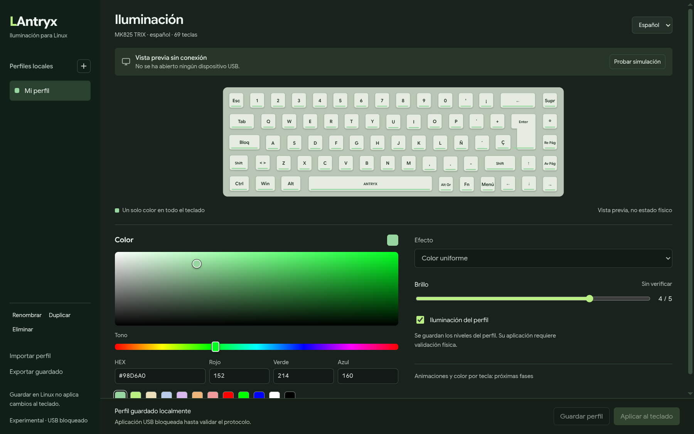

# LAntryx

**Tu teclado. Tu color. En Linux.**

Editor independiente para el Antryx MK825 TRIX: selector visual RGB, vista previa de 69 teclas y perfiles locales.

[English](README.md) · [Contribuir](CONTRIBUTING.md) · [Prueba con el teclado](docs/verification/hardware-session.md)



> **Experimental.** La aplicación funciona sin conexión. Aún no hay una prueba física satisfactoria de cambio de color. «Aplicar al teclado» está bloqueado deliberadamente; la prueba USB es un procedimiento separado y confirmado por el propietario.

## Ya funciona

- Elegir el RGB con clic o arrastre, barra de tono, teclado, HEX/RGB o muestras rápidas.
- Ver el color seleccionado en el teclado español de 69 teclas.
- Crear, renombrar, duplicar, eliminar, guardar, importar y exportar perfiles.
- Cambiar la interfaz entre español e inglés y conservar los perfiles al reiniciar.
- Guardar brillo/apagado como preferencias del perfil, SIN afirmar que ya funcionan en el dispositivo.
- Probar una simulación explícita, sin abrir dispositivos HID.

Guardar en Linux NO aplica cambios al teclado. La aplicación normal no enumera ni abre dispositivos USB al arrancar ni al editar.

## Ejecutar

Escritorio Linux, Node.js **22.12+** (probado con 22.22.0) y npm. Todavía no hay instalador.

```sh
npm ci --ignore-scripts
node node_modules/electron/install.js
npm run dev:offline
```

El segundo comando descarga Electron; no compila el proyecto. No uses `sudo`, no desactives el sandbox y no ejecutes reconstrucciones nativas automáticas si falla un módulo. La prueba aislada usa ioctl de la biblioteca estándar de Python 3, sin módulos nativos de Node. Python 3 se necesita para las comprobaciones y la prueba física, no para editar sin conexión. El backend experimental está limitado a Linux x86_64.

Los perfiles se guardan en el directorio de datos de usuario de Electron. La exportación contiene la versión **guardada**, no el borrador sin guardar. La importación genera un identificador nuevo.

## Verificación

```sh
npm run typecheck
npm run check
npm run hardware:check -- --dry-run
```

No ejecutan builds ni acceden al teclado real. [Resultados y límites comprobados](docs/verification/software-checks.md).

Cuando estés frente al teclado, sigue la [guía de prueba física](docs/verification/hardware-session.md): identificación primero y, solo con confirmación, un único paquete RGB experimental. La inicialización, el efecto visible, el brillo/apagado y la persistencia siguen pendientes; no se enviarán comandos de firmware, matriz de teclas o escritura de perfiles.

## Código abierto

Código original bajo [MIT](LICENSE). Proyecto comunitario, no oficial ni afiliado a Antryx. No se distribuye su software propietario ni sus recursos gráficos. Las dependencias conservan sus licencias.

La imagen es una captura REAL de la aplicación sin conexión. La fotografía del teclado físico sigue pendiente de una imagen propia o con permiso de redistribución; [procedencia de recursos](docs/design/assets.md).
