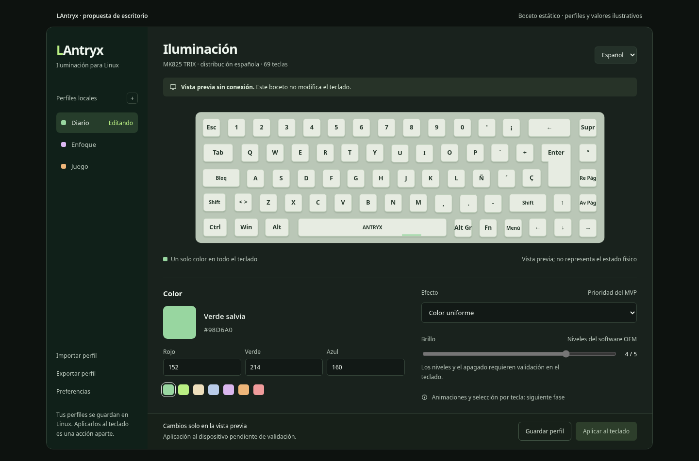

# LAntryx

**An independent Antryx keyboard lighting configurator for Linux.**

[Español](README.es.md) · [Product brief](PRODUCT.md) · [Design specification](docs/specs/2026-10-18-lantryx-design.md) · [Contributing](CONTRIBUTING.md)

> Planning and protocol-research stage. There is no runnable application or verified hardware support yet.

LAntryx aims to make one task reliable first: choose a uniform RGB color on an Antryx MK825 TRIX from Linux, without Wine. Local profiles, a visual keyboard, English/Spanish, verified lighting effects, brightness and speed follow that foundation.

## Desktop proposal

Design proposal, not an application screenshot or a photograph of the physical keyboard. All controls are inactive. [Open the static sketch](docs/design/preview/index.html) · [Visual review notes](docs/design/preview/README.md).

## Current evidence

Static analysis of the owner's OEM executable identified distinct live-RGB, effect-color and profile operations. These observations have not passed a physical hardware test. Matching a USB vendor/product ID does not establish compatibility.

Read the [research summary](docs/research/protocol-status.md). Raw decompiler output, proprietary binaries and unreviewed USB captures are not part of this repository.

## Planned experience

- Visual Spanish-layout keyboard with an explicit preview state.
- Uniform color with a clickable/draggable color picker, synchronized HEX/RGB input and saved swatches.
- Named local profiles with import/export.
- English and Spanish interface.
- Only verified device capabilities enabled for hardware application.
- Clear device, permission and pending-change states.

Saving a local profile must not silently write to the device. Preview success must not be presented as hardware success.

## Development status

The [application structure](docs/architecture/application-structure.md) describes intended responsibility boundaries, not existing source files. The owner accepted the direction; the [implementation plan](docs/superpowers/plans/2026-10-18-offline-app-and-hardware-probe.md) now awaits review before application scaffolding and execution.

No installation or launch commands are published because no application exists yet. Builds are not run automatically during this work.

## Product imagery and licensing

The README's planned hero is a real MK825 product photo, not a generated hardware photograph. Its source and redistribution terms must be recorded before publication; no image has been cleared yet. See [asset provenance](docs/design/assets.md).

MIT is the proposed license for original project code, pending confirmation. No code license is asserted for vendor images, marks, binaries or decompiler output. This documentation does not redistribute those materials.

## Independence and safety

LAntryx is a community project and is not affiliated with, endorsed by, or an official product of Antryx. Product names identify the intended hardware.

Firmware flashing, bootloader commands, key remapping and macros are outside the initial scope. Do not run the app as root or send experimental command sequences to a keyboard merely because its USB ID matches.
